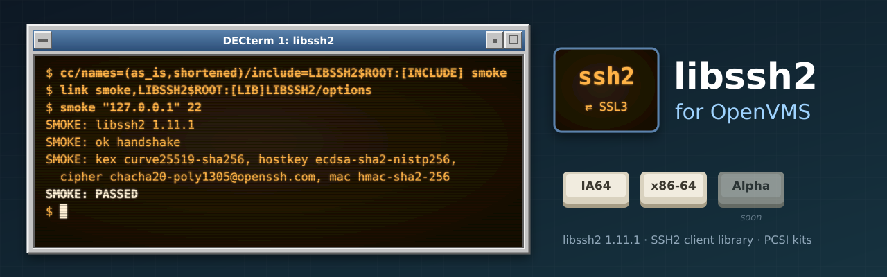

<p align="center">
  
</p>

# libssh2 for OpenVMS

[](https://github.com/issinoho/vms-libssh2/releases/latest)
[](https://github.com/issinoho/vms-libssh2/releases)

[](COPYING)

[libssh2](https://libssh2.org) (**1.11.1**), the client-side SSH2 library, built natively for
OpenVMS on **IA64** and **x86-64** with VSI C against VSI's **SSL3** kit (OpenSSL 3.0). It is
an object library for static linking, made for [VFTP](https://github.com/issinoho/vms-vftp),
the family's full-screen FTP, SFTP and SCP client, and part of the
[ports and tools for OpenVMS](https://openvms.issinoho.com) family.

Like the family's other ports, this repository holds **only our changes**: every build starts
from the signed release tarball (Daniel Stenberg's key, pinned in `keys/`), applies
`patches/` and adds `overlay/`.

**Status: 1.11.1-vms1, released: PCSI kits for both architectures on the
[releases page](https://github.com/issinoho/vms-libssh2/releases/latest).**

| | IA64 (V8.4-2L3) | x86-64 (E9.2-4) |
|---|---|---|
| Builds (VSI C, SSL3) | yes | yes |
| Handshake, host key SHA-256, known_hosts check | yes | yes |
| Public-key and password login | yes | yes |
| SFTP list, read, write, read and write at an offset, rename, setstat | yes, through VFTP | yes, through VFTP |
| SCP send and receive | yes, through VFTP | yes, through VFTP |
| The kit: install, a program built against it, remove | yes | yes |

Negotiated with VSI OpenSSH 9.9 and GitHub: curve25519-sha256, ecdsa-sha2-nistp256 host
keys, chacha20-poly1305@openssh.com. VFTP's live tests (its docs/NOTES.md) cover SFTP to
VMS sshd and to OpenSSH on Linux, and SCP to OpenSSH.

## Installing the kit

A kit downloaded through a non-VMS system loses its record format. Restore it, then install:

    $ SET FILE/ATTRIBUTE=(RFM:FIX,LRL:8192,MRS:8192,RAT:NONE) ISSINOHO-*-LIBSSH2-V0111-1E1-1.PCSI
    $ PRODUCT INSTALL LIBSSH2 /PRODUCER=ISSINOHO /SOURCE=dev:[dir]

It installs `LIBSSH2$ROOT:[LIB]LIBSSH2.OLB` and `LIBSSH2.OPT`, the headers in
`LIBSSH2$ROOT:[INCLUDE]` and `SYS$STARTUP:LIBSSH2$STARTUP.COM` (add it to
`SYSTARTUP_VMS.COM`). Build a program with

    $ define/process OPENSSL SSL3$INCLUDE:
    $ cc /names=(as_is,shortened) /define=(_USE_STD_STAT=1,_LARGEFILE) -
         /include=LIBSSH2$ROOT:[INCLUDE] prog.c
    $ link prog,LIBSSH2$ROOT:[LIB]LIBSSH2/options

`_USE_STD_STAT` and `_LARGEFILE` must match the library's (libssh2_scp_recv2 fills a
`struct stat`). The program needs only SSL3 where it runs: the library is linked in.

## Building

```sh
tools/prepare.sh            # fetch, verify, patch, stage
tools/build.sh x86          # or ia64
tools/kit.sh x86            # the PCSI kit, to out/kits/
tools/installcheck.sh x86   # install, smoke-test, remove (changes the system)
```

On the node the result is `[.INSTALL_<arch>.LIB]LIBSSH2.OLB` with `LIBSSH2.OPT` (the
library and `SYS$SHARE:SSL3$LIBCRYPTO_SHR32`) and the headers in
`[.INSTALL_<arch>.INCLUDE]`. Compile programs with `/NAMES=(AS_IS,SHORTENED)` and link
with `LINK prog,dev:[dir.INSTALL_<arch>.LIB]LIBSSH2/OPTIONS`.

## Changes

| Patch | What |
|---|---|
| 0001 | `vms/libssh2_config.h`: drop typedefs VSI C now has (`uint32_t`, `socklen_t`, `ssize_t`), add `HAVE_STRTOLL`, no zlib |

Ours: `vms/build.com` (the build), `vms/ssh2_smoke.c` (the smoke test) and `vms/kit/` (the PCSI kit).

## Artwork

`docs/images/banner.svg` and `docs/images/icon.svg` were made for this project in the style
of classic DECwindows and VT terminals, like those of its sibling ports.

## Licence

libssh2's BSD-3-Clause licence ([COPYING](COPYING), upstream's); our patches and VMS files are
under the same terms.

OpenVMS is a trademark of VMS Software, Inc. This project is not affiliated with VMS
Software, Inc. or with the libssh2 project.
